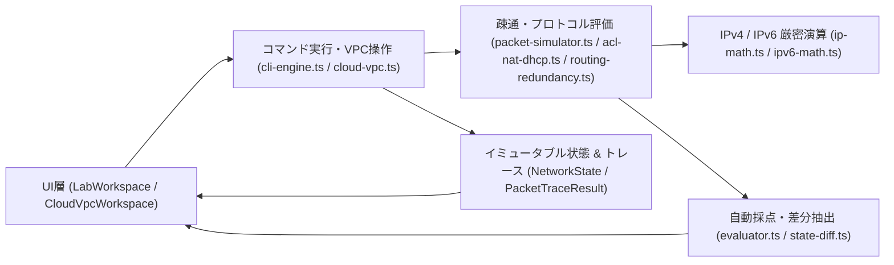

# NetForge — 体験型ネットワーク学習プラットフォーム

完全未経験から **CCNA 合格レベル**、さらには **実務（Linux / Webインフラ / AWS VPC / NetOps）** までを一気通貫で学べる、純粋 TypeScript 製イミュータブル仮想ネットワークエンジン搭載の体験型ネットワーク学習 Web アプリケーションです。

> **「叩いて、壊して、直す。」**
> ブラウザ上で完結する仮想 Cisco IOS CLI・Linux ホスト・AWS VPC 環境を使い、図解カリキュラムから構築ラボ、リアル障害対応シミュレータ、パケット解析、総合実力診断までをアカウント登録不要・ローカル完結で体験できます。

---

## ハイライト

- **純粋 TypeScript 製・イミュータブル仮想ネットワークエンジン**: 外部バックエンドや実機不要で、L2 (VLAN / 802.1Q / STP)・L3 (Static / OSPF / HSRP)・L4 (ACL / NAPT / DHCP)・DNS / HTTP(S)・AWS VPC (IGW / NAT GW / SG / NACL) をブラウザ内で決定論的にシミュレーション。
- **ローカル完結 & JSON バックアップ/復元**: 学習進捗・クイズ成績・ドリル統計・診断結果はブラウザの `localStorage` に自動保存され、JSON 形式でのエクスポート／インポートにも対応。
- **`Cmd + K`（`Ctrl + K`）グローバル横断検索**: 全カリキュラム記事・構築ラボ・障害チケット・クラウド課題・ツール・CLI 逆引きコマンドを即座に検索・ジャンプ（コマンドはワンクリックコピー対応）。
- **自動採点 & ビジュアルフィードバック**: すべての構築ラボ・障害対応チケットに自動評価ロジックと 3 段階ヒントを搭載し、疎通結果やヘッダ変換をトポロジ SVG 上で可視化。

---

## 主な機能・画面構成

| ルート | 画面名 | 概要 |
| --- | --- | --- |
| `/` | **ダッシュボード** | 総合進捗、「前回の続きから再開」カード、連続学習ストリーク、完全未経験向け 3 ステップ・スタートガイド（初回表示）、Stage 1〜3 ロードマップ、6 領域スキルレーダーチャート、弱点に基づく「今日の復習処方箋」、JSON バックアップ／復元 |
| `/learn` | **体系的カリキュラム一覧** | Stage 1（IT基礎）〜 Stage 3（実務・最新トレンド）まで全 20 記事をステージ別に整理 |
| `/learn/[stage]/[slug]` | **レッスン記事詳細** | 初学者向け図解モード／試験対策コマンドモードの切替、インライン用語ツールチップ、章末確認クイズ |
| `/labs/cli` | **CLI 構築ラボ** | 仮想 Cisco IOS コンソールを用いた設計・構築演習（全 8 シナリオ） |
| `/labs/troubleshoot` | **リアル障害対応シミュレータ** | 現場の障害チケットを CLI / Linux コマンドで調査・復旧する演習（全 9 シナリオ、タイムアタック・ミニ障害報告書付き） |
| `/labs/cloud` | **クラウド VPC ラボ** | AWS VPC の Route Table / IGW / NAT GW / Security Group / NACL を操作する演習（全 3 シナリオ） |
| `/labs/sandbox` | **フリービルド・サンドボックス** | ルータ・L2スイッチ・PC・サーバの自由追加/結線、JSON 入出力、Base64URL 共有対応の自由設計ラボ |
| `/tools` | **実践ミニツール＆ドリル** | IPv4 サブネット計算機＆ランダム出題、IPv6 (RFC 5952) 圧縮・展開＆種別クイズ、Wireshark 風 3 ペインパケット解析（6 ケース）、構成図・コンフィグ Diff レビュー（6 ケース） |
| `/exam` | **総合実力診断・模擬試験** | 全 6 領域均等出題の模擬試験、誤答リベンジノート、レーダーチャート連動、弱点処方箋生成、ランダム障害対応チャレンジ |

### 仮想ラボ共通機能（`/labs/cli`, `/labs/troubleshoot`）

- **インタラクティブ・トポロジ SVG**: 機器選択、リンクの Up/Down 状態・STP ブロッキング・HSRP Active/Standby 表示、パケットホップアニメーションとホップ毎の L2/L3/L4/NAT ヘッダ分解。
- **高機能仮想ターミナル**: コマンド履歴（↑↓）、`Tab` 補完、`?` コンテキストヘルプ、前方一致コマンド省略、誤入力サジェスト、環境リセット。
- **ステップ伴走ガイド（ON/OFF 切替）**: 現在の CLI モード解説、次の未達成ゴール表示、対象機器へのワンクリック切替、入力例プレビュー。
- **スナップショット制御 & Diff**: コマンド実行ごとの状態スナップショットによる Undo / Redo、操作タイムラインの自動リプレイ、初期状態からのコンフィグ Diff 表示。
- **学習サポート**: 3 段階ヒントパネル、逆引き CLI チートシートドロワー、リアルタイム目標達成判定とクリア祝福 UI（障害対応ラボでは復旧タイム／コマンド数記録とポストモーテム振り返り）。

---

## カリキュラム・シナリオ一覧

<details>
<summary><strong>カリキュラム全 20 記事（Stage 1: 6記事 / Stage 2: 9記事 / Stage 3: 5記事）</strong></summary>

#### Stage 1: 完全未経験〜IT基礎（6 記事）
1. `stage1/lan-wan` — LAN / WAN とネットワークの全体像
2. `stage1/osi-tcpip` — OSI参照モデル & TCP/IP カプセル化
3. `stage1/ip-mac` — IPアドレスとMACアドレス・ARPの仕組み
4. `stage1/subnetting` — サブネットマスクとCIDR計算の完全攻略
5. `stage1/tcp-udp` — TCP / UDP とポート番号・3ウェイハンドシェイク
6. `stage1/dns-http` — DNS名前解決とHTTP/HTTPS通信の流れ

#### Stage 2: CCNA合格レベル（9 記事）
1. `stage2/vlan-trunk` — VLAN・802.1Qトランク & Router-on-a-Stick
2. `stage2/stp-etherchannel` — STP (スパニングツリー) と EtherChannel
3. `stage2/static-ospf` — スタティックルートとOSPF・最長一致 (LPM)
4. `stage2/nat-napt` — NAT / NAPT (PAT) によるアドレス変換
5. `stage2/acl-security` — ACL (アクセス制御リスト) と暗黙のdeny
6. `stage2/cisco-ios` — Cisco IOS 基本操作と階層コマンド体系
7. `stage2/ipv6-fundamentals` — IPv6基礎（アドレス構造・圧縮ルール・SLAAC / NDP）
8. `stage2/network-management` — ネットワーク管理・監視（SSH・CDP/LLDP・NTP・Syslog・SNMP）
9. `stage2/l2-security-wireless` — L2セキュリティと無線LAN（Port Security・DHCP Snooping・WLC/WPA3）

#### Stage 3: 実務・最新トレンド（5 記事）
1. `stage3/troubleshooting-layers` — レイヤ別障害切り分けメソドロジー
2. `stage3/packet-analysis` — パケットキャプチャ読解と異常通信パターン
3. `stage3/cloud-vpc-vpn` — クラウドVPC設計・Security Group & VPN接続
4. `stage3/netops-automation` — ネットワーク自動化・REST API・AI運用 (NetOps)
5. `stage3/web-modern-network` — Webインフラとモダンネットワーク（TLS 1.3・LB・BGP・コンテナ網）

</details>

<details>
<summary><strong>CLI 構築ラボ（8 シナリオ）</strong></summary>

1. `cli-first-steps` — 【超入門】最初のCLI操作：ポート起動とPing疎通体験（初級 / Stage 1）
2. `cli-basic-routing` — 基本IP設定とL3ルーティング疎通（初級）
3. `cli-vlan-roas` — VLAN分割とRouter-on-a-Stick（中級）
4. `cli-nat-acl-web` — 社内LANからインターネットへのNAPT（PAT）とWebアクセス許可ACL（実践）
5. `cli-ospf-cost` — 3台ルータ構成でのOSPFシングルエリア構築とコスト制御（実践）
6. `cli-stp-root-bridge` — STPルートブリッジ選出と冗長リンクのブロッキング制御（中級）
7. `cli-etherchannel-lacp` — EtherChannel (LACP) によるスイッチ間リンクアグリゲーション（中級）
8. `cli-ipv6-basic` — IPv6 ルーティング設定とデュアルホスト疎通構築（中級）

</details>

<details>
<summary><strong>リアル障害対応シミュレータ（9 シナリオ）</strong></summary>

1. `ts-vlan-mismatch` — 「営業部PCだけ社内サーバに繋がらない」（初級）
2. `ts-dns-failure` — 「IP直打ちなら繋がるがURL（ホスト名）で開かない」（中級）
3. `ts-routing-asymmetric` — 「拠点間Pingがタイムアウトする」（実践）
4. `ts-acl-web-blocked` — 「特定の部署だけWebサーバ（TCP 80）に繋がらない」（中級）
5. `ts-dhcp-failure` — 「新規PCにIPアドレスが自動配布されない」（中級）
6. `ts-ospf-neighbor-down` — 「OSPFネイバーが確立せず対向拠点へ到達できない」（中級）
7. `ts-hsrp-failover-broken` — 「冗長化構成でActiveルータが落ちたのに通信が復旧しない」（実践）
8. `ts-port-security-errdisable` — 「会議室ハブを繋いだ後から通信が完全に途絶えた (err-disabled)」（中級）
9. `ts-linux-nginx-down` — 「Pingは通るのにWebサイト(HTTP/HTTPS)がConnection refusedになる」（中級）

</details>

<details>
<summary><strong>クラウド VPC ラボ（3 シナリオ）</strong></summary>

1. `cloud-igw-sg-https` — 「Public SubnetのWebサーバに外部からHTTPSアクセスできない」（中級）
2. `cloud-nacl-ephemeral` — 「NACLでインバウンド80番を許可したのにレスポンスが返らない」（実践）
3. `cloud-private-nat-egress` — 「Private Subnetのアプリサーバから外部API(HTTPS 443)へ通信できない」（実践）

</details>

---

## 仮想ネットワークエンジン設計 (`src/lib/network-engine/`)

`src/lib/network-engine/` は **UI 非依存・純粋 TypeScript・イミュータブル状態遷移・JSON シリアライズ可能** として設計されています。React コンポーネントは入力コマンドやトポロジ操作をエンジンへ渡し、返却される新しい状態とトレース結果を描画します。



---

## 技術スタック

| カテゴリ | 採用技術 |
| --- | --- |
| フレームワーク | Next.js 16 (App Router / Turbopack) |
| UI / 言語 | React 19, TypeScript 5 (`strict: true`) |
| スタイリング | Tailwind CSS v4, Lucide React, Framer Motion |
| 状態管理・永続化 | Zustand 5 (`persist` ミドルウェア / `localStorage`) |
| テスト・Lint | Vitest 5, ESLint 9 (Flat Config / `eslint-config-next`) |

---

## セットアップ・起動手順

### 前提環境

- Node.js 20 以上推奨（動作確認環境: Node.js v24 / npm 11）

### ローカル起動

```bash
git clone https://github.com/muu0726/Netowork-Study.git
cd Netowork-Study
npm install
npm run dev
```

起動後、ブラウザで `http://localhost:3000` にアクセスしてください。

---

## 利用可能な npm スクリプト

| コマンド | 説明 |
| --- | --- |
| `npm run dev` | Next.js 開発サーバを起動 |
| `npm run build` | 本番用アプリケーションをビルド（31 静的/SSG ルート生成） |
| `npm run start` | ビルド済み本番サーバを起動 |
| `npm run typecheck` | TypeScript 型チェック (`tsc --noEmit`) |
| `npm run lint` | ESLint による静的解析 (`eslint .`) |
| `npm test` | Vitest 単体テストスイートを 1 回実行 (`vitest run`) |
| `npm run test:watch` | Vitest をウォッチモードで実行 |
| `npm run test:e2e` | Playwright ブラウザ E2E テストを実行 (`playwright test`) |

### テスト概要

`npm test` では **18 テストファイル・103 テスト** を実行し、以下を自動検証しています。

- IPv4 / サブネット / LPM / ワイルドカード演算および IPv6 圧縮・展開・分類ロジック
- Cisco IOS / Linux CLI パーサ、パケットシミュレータ、ACL / NAT / DHCP、OSPF / STP / HSRP、EtherChannel (LACP) / Port Security / IPv6 ルーティング、クラウド VPC、サンドボックス構成ビルダー、ヘッダ分解、コンフィグ Diff
- 全 17 本の CLI・障害対応シナリオにおける `initialState` の JSON シリアライズ性・初期不合格・`solutionCommands` 実行後の全目標合格
- 全 20 記事のカリキュラムデータ構造・クイズ整合性
- グローバル検索、総合実力診断エンジン、Zustand 学習進捗ストアおよびバックアップ JSON パース

---

## ディレクトリ構成

```text
.
├── docs/
│   └── tasks.md                 # Phase 1〜8 実装タスク管理
├── src/
│   ├── app/                     # Next.js App Router ページ群 (/, /learn, /labs/*, /tools, /exam)
│   ├── components/              # UI コンポーネント (dashboard, exam, labs, layout, learn, tools, ui)
│   ├── data/                    # カリキュラム記事・ラボ/障害/クラウドシナリオ・演習ドリル・チートシート
│   ├── hooks/                   # Hydration 対策フック (useHydrated)
│   ├── lib/                     # 仮想ネットワークエンジン (network-engine/), 診断エンジン, 横断検索
│   └── store/                   # Zustand 学習進捗ストア & バックアップシリアライザ
├── eslint.config.mjs
├── next.config.ts
├── package.json
├── tsconfig.json
└── vitest.config.mts
```

---

## 関連ドキュメント

- 実装フェーズの詳細は [docs/tasks.md](./docs/tasks.md) を参照してください。
